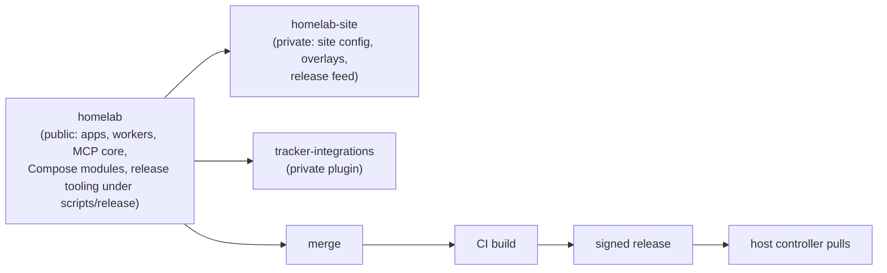

# Homelab Docker Template

This repository is a generic, off-host Docker Compose platform for reusable
services, workers, and MCP tooling. It is intentionally safe to render with
fictional values and synthetic secrets; it does not contain a deployment
identity or private host topology.

## Documentation map

- [Architecture overview](docs/architecture/overview.md)
- [Threat model](docs/architecture/threat-model.md)
- [Getting started](docs/getting-started.md)
- [Public Caddyfile](config/caddy/Caddyfile)

## Architecture at a glance

The public platform routes generic requests through Compose services. A single
trusted controller applies a private site overlay, while CI/CD remains limited
to rendering, tests, and scans. The public architecture uses a fictional
two-service `hello`/`whoami` example and grants its synthetic secret as a file.

Real ingress routes, host storage, service enablement, and site identities are
private deployment inputs. Optional private integrations register through the
platform extension interface and are not imported by default.

This diagram shows the public platform, private extensions, and planned release flow.



## Quick Start

```bash
cp .env.example .env.local
docker compose --env-file .env.example config --quiet
python3 -m unittest -v tests.boundary.test_pr02_task4_caddy \
  tests.boundary.test_pr02_task5_compose \
  tests.boundary.test_pr02_task6_secrets \
  tests.boundary.test_pr02_task7_history \
  tests.boundary.test_pr02_task8_docs
```

The public example uses `example.homelab.local`, relative `example-data`
directories, and synthetic secret values. Never commit a runtime `.env`, secret
file, database, session cookie, or certificate. For the fictional two-service
walkthrough, follow [Getting started](docs/getting-started.md).

## Features

- Generic worker and MCP packages that can be tested off-host.
- Parameterized Compose modules with synthetic defaults.
- Explicit private overlays for site and tracker integrations.

## License

MIT. See [LICENSE](LICENSE).
