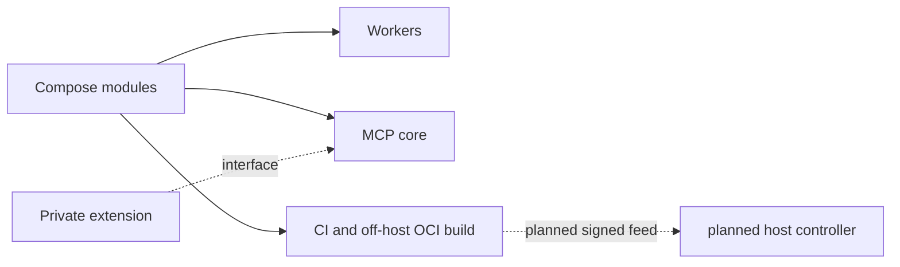

# Homelab Docker Template

This is a public, generic Docker Compose platform for self-hosted services,
workers, and MCP tooling. It is safe to inspect and validate off-host with
fictional values; it is not a ready-made deployment for a particular site.

**Status: Current and planned.** The table below distinguishes shipped
capabilities from explicitly planned work.

## Documentation map

Every page labels claims as **Current** or **Planned**. Start with
[the docs index](docs/README.md), then use [Getting started](docs/getting-started.md)
for the public validation path. [Architecture](docs/architecture/overview.md),
[configuration](docs/configuration.md), and [development](docs/development.md)
cover the main extension points.

## Current status

| Area | Status | Details |
| --- | --- | --- |
| Compose modules | Built | [compose/](compose/base.yml) aggregates the public modules. |
| Workers | Built | [apps/homelab-workers/](apps/homelab-workers/) contains packaged workers. |
| MCP core + extension interface | Built | [apps/homelab-mcp/](apps/homelab-mcp/) exposes the core and private extension boundary. |
| CI | Built | [`.github/workflows/ci.yml`](.github/workflows/ci.yml) renders, tests, scans, and builds. |
| Off-host OCI build lane | Built | CI builds images without deploying them. |
| Signed release feed (N6) | Built | See [release notes](docs/operations.md). |
| Host controller (N7–N11) | Planned | No controller or host pull path is shipped. |

## Architecture at a glance



The public repository ends at the CI/build boundary. Private site overlays may
connect extensions at runtime; the host controller remains planned.

## Quick Start

Prerequisites: Docker Compose v2 and Python 3.11+. From a fresh clone, run:

```bash
cp .env.example .env.local
bash scripts/ci/public-check.sh
```

The check creates disposable synthetic secret files in a temporary directory,
renders Compose with `.env.example`, runs the local Compose tests, checks links,
runs the boundary/CI/release tests, and runs the public-readiness scan. It does
not apply Compose or start containers. Expected final output is:

```text
161 passed, 7 skipped
Public check passed.
```

The exact test count may change as the suite grows; every command must exit 0.
`.env.local` is only a local copy of the public contract and must not contain
real credentials or be committed.

## Repository layout

```text
apps/                 services, workers, and MCP core
compose/              current Compose modules
config/               public service configuration
docs/                 current/planned public documentation
scripts/ci/           reproducible validation helpers
scripts/release/      current build-policy and artifact tooling
tests/                boundary, CI, Compose, and release tests
```

The modules are [base.yml](compose/base.yml), [network.yml](compose/network.yml),
[arr.yml](compose/arr.yml), [media.yml](compose/media.yml),
[download.yml](compose/download.yml), [workers.yml](compose/workers.yml),
[autobrr.yml](compose/autobrr.yml), [llm.yml](compose/llm.yml), and
[files.yml](compose/files.yml).

## Private extensions

Private code plugs in through documented interfaces rather than public site
values. For example, a fictional `tracker-extension` can implement the MCP
extension contract, be installed by a private overlay, and set
`HOMELAB_MCP_EXTENSIONS=tracker-extension`; the public repository does not
contain that package, its credentials, or its routes. Private projects such as
`homelab-site` and `tracker-integrations` are examples of that boundary.

## Features

- Parameterized Compose modules with synthetic defaults.
- Packaged workers and an MCP core with an extension interface.
- CI validation and an off-host OCI build lane.

## License

MIT. See [LICENSE](LICENSE).
