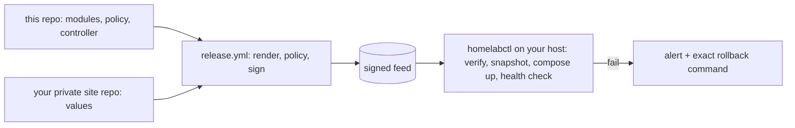

# Homelab

A guided setup path is in development. Today's install guides describe an advanced route; they require manual
configuration and are intended for technically experienced users.

A small, auditable platform for running self-hosted services with Docker Compose on one Linux host. You describe
services as plain Compose files, keep your own values in a private repo, and every merge becomes a signed release
that a small controller on the host verifies and applies, with a snapshot before each change and an alert when
something fails.

It ships a media-server catalog (Plex, Jellyfin, Sonarr, Radarr, Prowlarr, Bazarr, qBittorrent, Seerr, autobrr,
FlareSolverr, Caddy, cloudflared), but the platform doesn't care what the services are.

## How it works



- **Modules:** one Compose file per service, digest-pinned, checked against a security policy
  ([modules](docs/modules.md)).
- **Site:** a private repo with `site.yaml`, `site.env` and config files; no code ([configuration](docs/configuration.md)).
- **Releases:** signed with Sigstore keyless signing by this repo's workflow; the host trusts nothing else.
- **Controller:** about 550 lines of Python on a systemd timer; state is plain files ([architecture](docs/architecture/overview.md)).
- **Updates:** Dependabot bumps image digests; patch and minor app updates deploy unattended.

## Start here

| I want to… | Read |
|---|---|
| understand the design | [Architecture](docs/architecture/overview.md), then [decisions](docs/decisions/README.md) |
| know what accounts I need | [Accounts and external services](docs/accounts.md) |
| try it without a server | [Getting started → off-host](docs/getting-started.md#try-it-off-host) |
| set up a host | [Getting started → real host](docs/getting-started.md#set-up-a-real-host) |
| expose something safely | [Ingress](docs/ingress.md) and [Security](docs/security.md) |
| run it day to day | [Operations](docs/operations.md), [Troubleshooting](docs/troubleshooting.md) |
| add a service or contribute | [Development](docs/development.md) |
| change it with an LLM | [AGENTS.md](AGENTS.md) |

All docs: [docs/README.md](docs/README.md).

## Quick check

```bash
cp .env.example .env.local
bash scripts/ci/public-check.sh
```

Runs the documentation, boundary, CI and release tests and the public-readiness scan with synthetic values. It
never starts a container.

## Repository layout

```text
modules/      one Compose file per service (app and edge tiers)
scripts/      release tooling (runs in Actions) and the controller (runs on the host)
host/         install, backup and migration scripts for the host
config/       Caddy image, Infisical templates, release policy allowlists, CI budgets
examples/     a synthetic site and plugin
docs/         guides and decision records
tests/        see docs/development.md
```

## License

MIT. See [LICENSE](LICENSE).
