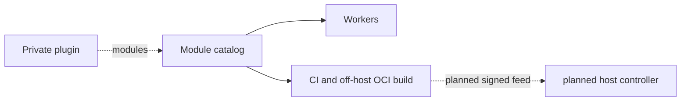

# Homelab Docker Template

This is a public, generic Docker Compose platform for self-hosted services and
workers. It is safe to inspect and validate off-host with
fictional values; it is not a ready-made deployment for a particular site.

**Status: Current and planned.** The table below distinguishes shipped
capabilities from explicitly planned work.

## Documentation map

Every page labels claims as **Current** or **Planned**. Start with
[the docs index](docs/README.md), then use [Getting started](docs/getting-started.md)
for the public validation path. [Architecture](docs/architecture/overview.md),
[configuration](docs/configuration.md), and [development](docs/development.md)
cover the main extension points.

## Current status

| Area | Status | Details |
| --- | --- | --- |
| Module catalog | Built | [modules/](modules/app/) contains the public service modules. |
| Workers | Built | [apps/homelab-workers/](apps/homelab-workers/) contains packaged workers. |
| CI | Built | [`.github/workflows/ci.yml`](.github/workflows/ci.yml) renders, tests, scans, and builds. |
| Off-host OCI build lane | Built | CI builds images without deploying them. |
| Signed release feed (N6) | Built | See [release notes](docs/operations.md). |
| Host controller (N7–N11) | Planned | No controller or host pull path is shipped. |

## Architecture at a glance



The public repository ends at the CI/build boundary. Private site overlays may
connect extensions at runtime; the host controller remains planned.

## Quick Start

Prerequisites: Python 3.11+. From a fresh clone, run:

```bash
cp .env.example .env.local
bash scripts/ci/public-check.sh
```

The check runs documentation, boundary, CI, release, and public-readiness
checks. It does not deploy services or start containers.

```text
161 passed, 7 skipped
Public check passed.
```

The exact test count may change as the suite grows; every command must exit 0.
`.env.local` is only a local copy of the public contract and must not contain
real credentials or be committed.

## Repository layout

```text
apps/                 worker source and tests
modules/              one Compose module per public service
config/               public service configuration
docs/                 current/planned public documentation
scripts/ci/           reproducible validation helpers
scripts/release/      current build-policy and artifact tooling
tests/                boundary, CI, module, and release tests
```


## Private extensions

Private plugins add owner-specific modules through the documented plugin
layout. The public repository contains no private site values or plugin code.

## Features

- Parameterized Compose modules with synthetic defaults.
- Packaged worker images used by the catalog.
- CI validation and an off-host OCI build lane.

## License

MIT. See [LICENSE](LICENSE).
