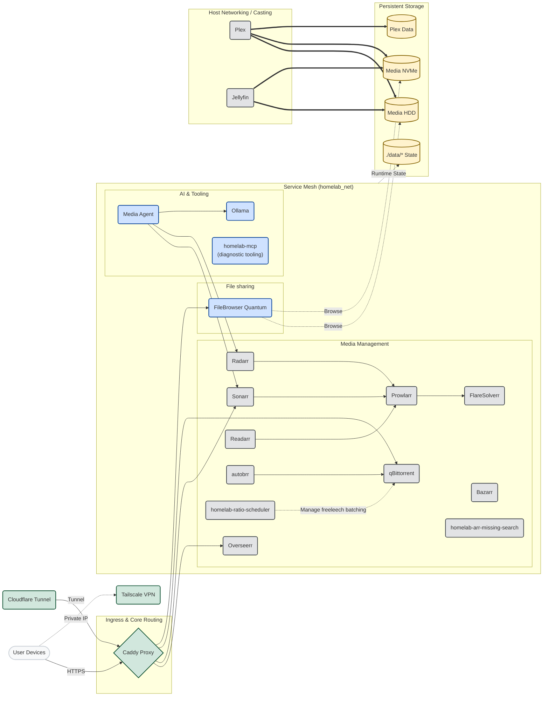
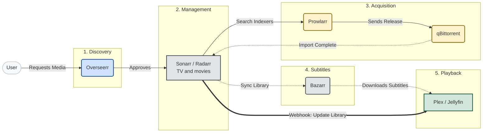

# Architecture

[← Back to README](../README.md)

Full service diagram, repository layout, network summary, and data-flow view.
For WAN port ownership see [ingress.md](ingress.md).

<details>
<summary>▶ Full architecture (all services)</summary>



<details>

<summary>diagram source</summary>



</details>

</details>

## Repository Structure

```text
.
├── docker-compose.yml                # Root bundle (`include` → compose/base.yml)
├── compose/
│   ├── base.yml                      # Aggregates compose fragments + homelab_net / llm_net
│   ├── network.yml                   # Edge services (Caddy, Tailscale, cloudflared)
│   ├── arr.yml                       # *arr stack (Sonarr, Radarr, Prowlarr, Bazarr, Overseerr, FlareSolverr)
│   ├── media.yml                     # Playback (Plex, Jellyfin)
│   ├── download.yml                  # qBittorrent + download-path mounts
│   ├── workers.yml                   # homelab-workers services (offload and maintenance)
│   ├── files.yml                     # FileBrowser Quantum (share.*)
│   ├── autobrr.yml                   # Autobrr release automation
│   └── llm.yml                       # Ollama, internal dashboard, homelab-mcp
├── .env.example                      # Baseline environment contract
├── config/
│   ├── caddy/                        # Caddyfile + Dockerfile for local image
│   ├── cloudflared/                  # Tunnel template + README
│   ├── filebrowser/                  # FileBrowser Quantum config
├── apps/
│   ├── homelab-workers/              # Python worker package (pyproject + src layout)
│   ├── homelab-mcp/                  # MCP diagnostic/agent tooling
│   └── media-agent/                  # Media agent API service
├── scripts/
│   ├── ops/setup.sh
│   ├── README.md
│   └── hardening/                    # Host hardening scripts and security audit notes
├── tests/                            # compose / runtime / explicit integration smoke tests
└── data/                             # Runtime state (gitignored)
```

## Network Architecture

Bridge networking is the default because it limits exposure and keeps service-to-service DNS stable. Host mode is used only where protocol behavior requires it. WAN/LAN port ownership (`:443` VPN, `:8443` media, tunnel paths) is documented in [`ingress.md`](ingress.md).

| Service | Network mode | Why this mode is used | Security trade-off |
|---|---|---|---|
| `tailscale` | `host` | Needs `/dev/net/tun` and low-level networking | Elevated capabilities (`NET_ADMIN`, `NET_RAW`) |
| `cloudflared` | `host` | Tunnel agent sits on host ingress/egress boundary | Treat as edge component; protect tokens |
| `plex` | `host` | Improves LAN discovery and client compatibility | Media service directly reachable on host |
| `jellyfin` | `host` | Improves LAN discovery and client compatibility | Media service directly reachable on host |
| Most others (`caddy`, Arr apps, FileBrowser, LLM services, media-agent) | `bridge` on `homelab_net` | Internal-only mesh with Caddy ingress | Smaller attack surface and centralized routing |

## Data Flow Diagram



<details>
<summary>diagram source</summary>



</details>
