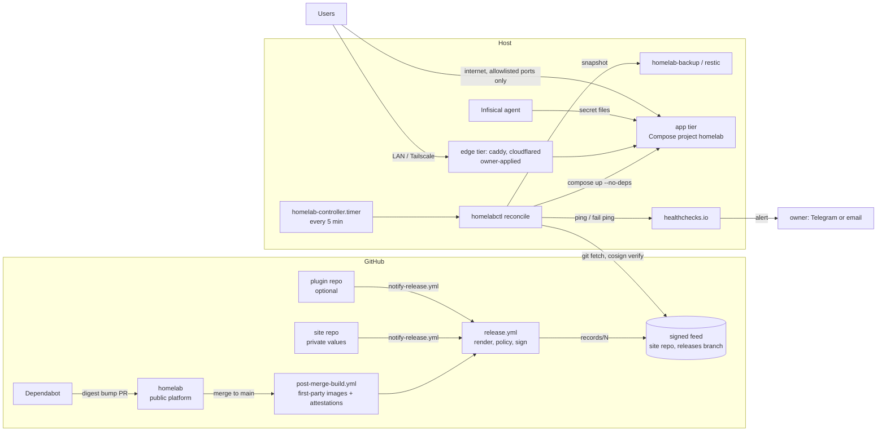

# Architecture

This page explains how the pieces fit together. Every rule here has a decision record in
[`docs/decisions/`](../decisions/README.md) explaining why.

## The idea in one paragraph

Services are plain Docker Compose files. A merge to any source repo produces a signed **release**: a numbered
statement of exactly which commits, image digests and rendered Compose models to run. A small controller on the
server applies the newest release, lets Compose work out what changed, snapshots stateful services first, checks
health, and halts loudly with the exact rollback command if anything fails. Merging is the approval. Everything
has a bypass: a release directory is a plain Compose project that stock `docker compose` can run.

## The whole system

## Repositories

| Repo | Visibility | Holds |
|---|---|---|
| `homelab` (this one) | public | module catalog, Compose policy, renderer, release workflow, controller, host scripts, first-party images (caddy, homelab-workers), docs, tests |
| site repo | private | `site.yaml`, `site.env`, `files/`, `overrides/`, `edge/` (Caddyfile, cloudflared config), code-free plugins, and the `releases` branch that is the signed feed |
| plugin repo | private, optional | code, image build and modules for services only one owner runs |

Dependency rule: site → platform and plugins; plugin → platform contract; platform → nothing private
([0002](../decisions/0002-public-platform-private-site.md)).

## Tiers

| Tier | Members | Changed by |
|---|---|---|
| host | Tailscale, controller and backup timers, Infisical agent, deadman pings | `host/install.sh` (systemd) |
| edge | caddy, cloudflared | the owner, from the current release ([operations](../operations.md#edge)) |
| app | every other module | the controller |
| unmanaged | anything else on the host | never this project |

See [0003](../decisions/0003-tiers.md).

## A release, step by step

1. A PR merges to `main` in `homelab`, the site repo or a plugin repo.
2. `post-merge-build.yml` builds any first-party image whose inputs changed and attests it.
3. `release.yml` checks out the platform, the site and each repo plugin at verified commits, then
   `scripts/release/render.py` selects the modules the site enables, adds overrides, inlines config files and
   runs `docker compose config` with an empty environment. `compose_policy.py` checks the result
   ([0008](../decisions/0008-compose-policy.md)).
4. `compile.py` bundles the rendered models (`app.json`, `edge.json`) and `site.yaml` into `bundle.tar`.
5. The record (`record.json`: sequence, source commits, image digests, bundle hash) is signed with cosign
   keyless and pushed to `records/<N>/` on the site repo's `releases` branch
   ([0004](../decisions/0004-signed-full-state-releases.md)).

## The controller loop

`homelabctl reconcile` runs from a systemd timer (2 minutes after boot, then every 5 minutes):

1. Take the lock. If `state/applying` exists, a previous run crashed: go DEGRADED.
2. If `state/DEGRADED` exists, send a fail ping with its reason and stop.
3. Host checks: free space on `/` and the media disk, disk markers, Docker reachable, container start errors.
   Any failure fails the ping, naming the cause.
4. Fetch the newest release above `highwater`. Older unapplied releases are skipped.
5. Verify the signature against the pinned workflow identity and the bundle hash; unpack to
   `/srv/homelab/releases/<N>/` read-only.
6. Plan: a managed app service changes when its Compose config hash differs from the running container's.
   Services the site marks `state: stopped` are created but not started. Edge changes are only reported.
7. Pull images and snapshot each changed stateful service (stopped first).
8. `docker compose -p homelab -f app.json up -d --no-deps` for the changed services.
9. Wait up to 180 s for each to be healthy.
10. Pass: move `current`/`previous`, advance `highwater`, OK ping. Fail: write DEGRADED with the
    `homelabctl rollback <svc>` command and alert. Nothing is restored automatically.

While `state/observe-only` exists, ticks do steps 1–6 only. See [0005](../decisions/0005-slim-controller.md).

## Host layout

Everything the platform owns is under `/srv/homelab/` (`trust/`, `tooling/`, `state/`, `releases/`, `data/`,
`retired/`); files outside it are listed in `/srv/homelab/HOST-FILES`
([0006](../decisions/0006-host-layout.md)). Media disks carry `.homelab-mounted` markers so a dead disk stops only
the services that use it ([0007](../decisions/0007-disk-markers.md)).

## Where the code is

| Path | What |
|---|---|
| `modules/app/`, `modules/edge/` | one Compose file per service |
| `scripts/release/` | render, Compose policy, compile, record, feed, release reconciler (runs in GitHub Actions) |
| `scripts/controller/` | `homelabctl` and its loop (runs on the host) |
| `host/` | `install.sh`, `homelab-backup`, `cutover.sh`, `move-data.sh` |
| `apps/homelab-workers/` | the first-party worker image (qBittorrent events, *arr post-import, missing search, Seerr reconciler) |
| `config/` | Caddy image and example Caddyfile, Infisical templates, release policy allowlists, CI budgets |
| `examples/` | a synthetic site and plugin used by tests and docs |
| `tests/` | see [development](../development.md#tests) |
