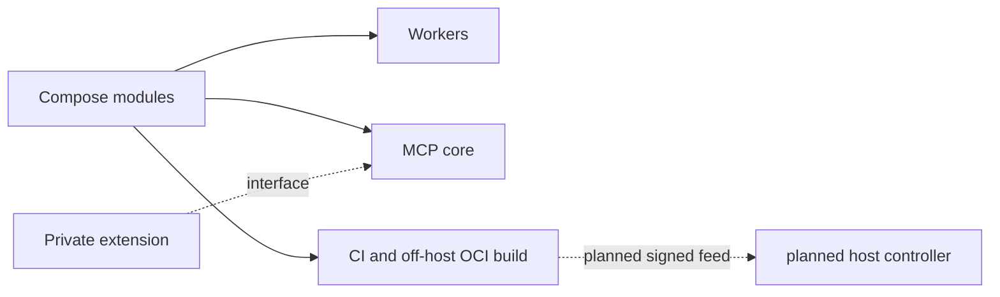

# Architecture overview

**Status: Current, with a planned release boundary.** The public stack contains
Compose modules, workers, MCP core, and an extension interface. The release
feed and host controller shown below are **Planned**.

The public example uses fictional `hello` and `whoami` services with the
synthetic secret `synthetic-demo-token-only` mounted as
`/run/secrets/demo_api_token`. Those names demonstrate an extension boundary;
they are not deployed by this repository.

Private site overlays supply deployment identity, routes, and credentials.
Only the generic contract is public. See [threat model](threat-model.md),
[configuration](../configuration.md), and [development](../development.md).

