# Operations

[← Back to README](../README.md)

CI/CD promotion path, security hardening, and operational policies.
Runbooks are maintained alongside the relevant service documentation.

## CI/CD

All development happens on the `dev` branch. Production runs from `main`.

```mermaid
flowchart LR
    %% -- Theme & Styling --
    classDef trigger fill:#f8f9fa,stroke:#ced4da,stroke-width:2px;
    classDef human fill:#cfe2ff,stroke:#084298,stroke-width:2px,stroke-dasharray: 5 5;
    classDef auto fill:#e2e3e5,stroke:#41464b,stroke-width:2px;
    classDef pass fill:#d1e7dd,stroke:#0f5132,stroke-width:2px;
    classDef fail fill:#f8d7da,stroke:#842029,stroke-width:2px;
    classDef storage fill:#fff3cd,stroke:#856404,stroke-width:2px;

    %% -- Triggers --
    Commit([Push to dev branch]):::trigger
    Cron([Nightly 2AM Schedule]):::trigger

    %% -- Stage 1: Validation --
    subgraph CI ["Stage 1: CI Validation"]
        direction TB
        Lint[Ruff Linter]:::auto
        Build[Docker Build]:::auto
        Test[Pytest Workers]:::auto

        Lint & Build & Test --> CIPass{CI Status}:::auto
    end

    %% -- Stage 2: Deployment --
    subgraph CD ["Stage 2: Continuous Deployment"]
        direction TB
        Backup[(Snapshot ./data/)]:::storage
        Deploy[Docker Compose Up]:::auto
        E2E[Run E2E Tests]:::auto

        Backup --> Deploy --> E2E
    end

    %% -- Outcomes --
    subgraph State ["End State"]
        direction TB
        Live([Production Live]):::pass
        Alert([GitHub Issue Cut]):::fail
        Restore[(Restore Snapshot)]:::storage
    end

    %% -- The Human Element --
    Merge{{Human: Squash & Merge}}:::human

    %% -- Routing Logic --
    Commit --> Lint & Build & Test
    CIPass -- Pass --> Merge
    CIPass -. Fail .-> Alert

    Merge --> Backup
    Cron -. Triggered on main .-> Backup

    E2E -- Pass --> Live
    E2E -- Fail --> Restore
    Restore --> Alert
```



<details>
<summary>diagram source</summary>



</details>

**Validate** (every push to `dev` and every PR):
- Compose config validation
- `docker compose build` for all local images (including custom Caddy from `config/caddy/`)
- Host port preflight on the self-hosted runner (blocks deploy if e.g. port 53 is held by systemd-resolved)
- pytest + ruff for workers and media-agent
- Bash syntax checks and README structure

Manual preflight before a deploy: `bash scripts/ci/ci-local.sh validate`

**Nightly deploy** (2 AM CEST, or manual via workflow dispatch):
1. Skips if `dev` has no new commits or if the latest validate is failing.
2. Fast-forward merges `dev` into `main` and pushes.
3. Runs `scripts/ops/backup-data.sh`: compresses `./data/` to a timestamped `.tar.gz` under `${MEDIA_HDD_PATH}/backups/homelab-data/` (Ollama **weights** under `data/llm/ollama/models/blobs/` are excluded; **manifests** stay so you know which models/tags were present), prunes archives older than 14 days. If this step fails, deploy does not run.
4. Pulls images and runs `docker compose up -d --build` on the server.
5. Waits for all healthchecks (up to 5 minutes).
6. Does **not** run media-pipeline E2E (that path is retired). Promotion must not download/delete test media or affect seed ratio.
7. On failure: reverts the merge on `main`, redeploys the previous revision, and opens a GitHub issue.

Nightly **skips** merge/deploy when `origin/dev` and `origin/main` point at the same commit (no new work to promote).

`bash scripts/ci/ci-local.sh nightly` runs validate plus the healthcheck gate.

To trigger a deploy without waiting for the nightly schedule:

```bash
gh workflow run "Nightly Deploy" --ref dev
```

## Security

Security relies on network segmentation, Caddyfile-defined routing, and low-privilege container defaults. The stack applies `no-new-privileges` and `cap_drop: [ALL]` broadly, and services are exposed through Caddy/Tailscale/Cloudflare intentionally rather than through extra host ports.

### Hardening scripts

Run `scripts/ops/setup.sh --harden` to apply file-permission lockdown and host firewall rules in one step. You can also run the scripts individually:

| Script | What it does |
|---|---|
| `scripts/hardening/secure-secret-file-permissions.sh` | `chmod 600` on `.env`, Arr config XMLs, qBittorrent config, and other secret-bearing files. Run after restoring configs or secrets. |
| `scripts/hardening/nftables-arr-stack.nft` | Host INPUT filter that restricts management ports (Caddy, DNS, media UIs) to RFC 1918 + Tailscale CGNAT ranges. Safe to reload (deduplicates automatically). |

```bash
# Apply both at once
./scripts/ops/setup.sh --harden

# Or individually
bash scripts/hardening/secure-secret-file-permissions.sh
sudo nft -f scripts/hardening/nftables-arr-stack.nft
```

### qBittorrent networking

qBittorrent runs on `homelab_net`. Sonarr, Radarr, Prowlarr, and media-agent reach it at `http://qbittorrent:8080`. The WebUI is proxied by Caddy at `/qbittorrent/` (LAN and Tailscale). This stack is for private trackers only — disable DHT and PeX in the qBittorrent WebUI. For ratio recovery, the BitTorrent **peer port** (`QBT_PEER_PORT`, default **51423**) is published on the host (`51423/tcp+udp` in `compose/media.yml`). Forward that port on your router to the homelab host.

### Cloudflare Tunnel and ToS

The Cloudflare Tunnel agent (`cloudflared`) provides public HTTPS ingress for Overseerr and select `home.*` services — see [`ingress.md`](ingress.md) for how tunnel, WAN `:8443`, and VPN `:443` split traffic. Large media streaming through the tunnel may conflict with Cloudflare's Terms of Service.

### Ollama LAN-only restriction

Ollama binds to `127.0.0.1:11434` on the host (loopback only) and is reachable by other containers via `homelab_net` internal DNS. There is no Caddy ingress label for Ollama, so it is not exposed to the public internet.

### Split-horizon DNS

Public Cloudflare DNS should not contain A records pointing to LAN IPs. Use `scripts/ops/dns-split-horizon.sh` to clear any remaining public LAN A records. Local LAN resolution (if needed) is operator-managed — Pi-hole is not part of this compose stack.

### Host firewall posture

The nftables ruleset (`scripts/hardening/nftables-arr-stack.nft`) filters the host INPUT chain:

- Management ports (DNS `:53`, HTTP `:80/:443`, Overseerr `:5055`, Jellyfin `:8096`, Plex `:32400`) are restricted to the documented example network (`192.0.2.0/24`) sources.
- All other traffic to those management ports is dropped.

UFW, if enabled, should be configured to not conflict with Docker's nftables/iptables rules. See [Docker and iptables](https://docs.docker.com/network/iptables/) for details.

### HSTS

All TLS-enabled Caddy sites set `Strict-Transport-Security: max-age=31536000; includeSubDomains` via the `header` directive in `config/caddy/Caddyfile`. This instructs browsers to only connect over HTTPS for one year.

### Authentication (planned)

Management UIs (Sonarr, Radarr, Prowlarr, qBittorrent, Readarr) are currently protected only by their built-in auth and LAN-only Caddy routing. A forward-auth middleware (Authelia or Caddy `basic_auth`) is planned but not yet deployed.

### User namespace remapping (advanced)

For additional container isolation, Docker supports user namespace remapping. Add to `/etc/docker/daemon.json`:

```json
{ "userns-remap": "default" }
```

This maps container root to an unprivileged host UID range. **Test thoroughly** before enabling — it can break volume ownership for containers that run as specific UIDs (Plex, Arr apps with `PUID`/`PGID`). This is a host-level change and is not applied automatically by the setup script.
