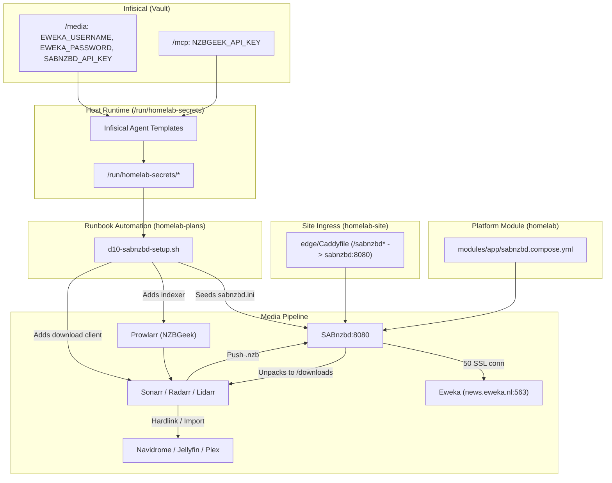

# Usenet (Eweka + SABnzbd + NZBGeek) Implementation Plan

> **For agentic workers:** REQUIRED SUB-SKILL: Use superpowers:subagent-driven-development to implement this plan task-by-task. Steps use checkbox (`- [ ]`) syntax for tracking.

**Goal:** Integrate Usenet into the homelab media stack via SABnzbd (Eweka news provider) and NZBGeek (Prowlarr indexer), complete with Infisical secret management, Caddy Tailscale ingress, and automated zero-UI runbook provisioning.

**Architecture:** Add a first-class catalog module `modules/app/sabnzbd.compose.yml` joined to `homelab_net` with persistent app data and shared download paths. Wire secrets (`EWEKA_*`, `NZBGEEK_API_KEY`, `SABNZBD_API_KEY`) via Infisical templates into tmpfs (`/run/homelab-secrets`). Expose SABnzbd securely via Caddy behind Authentik SSO, and automate initial configuration of `sabnzbd.ini`, Prowlarr indexers, and *arr download clients via a dedicated bash runbook (`d10-sabnzbd-setup.sh`).

**Architecture Diagram:**



**Tech Stack:** Docker Compose, SABnzbd (LinuxServer.io), Caddy, Infisical Agent, Prowlarr API, Servarr API (Sonarr, Radarr, Lidarr), Bash.

## Global Constraints

- One service per Compose file in `modules/<tier>/<service>.compose.yml` ([0001](../../decisions/0001-compose-modules.md)).
- Zero private values (no real domains, private IPs, credentials) in git repos ([0002](../../decisions/0002-public-platform-private-site.md)).
- Digest-pinned images only ([0009](../../decisions/0009-image-trust.md)).
- Secrets rendered into tmpfs from `${HOMELAB_SECRET_DIR}`; never in `environment:`, `site.env`, or git ([0010](../../decisions/0010-secrets.md)).
- No unallowlisted WAN port binds ([0015](../../decisions/0015-exposure-policy.md)).
- Zero manual UI steps: configuration must be automated via runbook scripts.
- `scripts/dev/gate` must pass in `homelab`.

---

### Task 1: Add SABnzbd Catalog Module in `homelab`

**Files:**
- Create: `modules/app/sabnzbd.compose.yml`
- Test: `scripts/dev/gate`

**Interfaces:**
- Consumes: Environment variables `${PUID}`, `${PGID}`, `${TZ}`, `${APP_DATA_DIR}`, `${DOWNLOADS_DIR}`.
- Produces: Service `sabnzbd` listening internally on `homelab_net` at port 8080.

- [ ] **Step 1: Create `modules/app/sabnzbd.compose.yml`**

Write `modules/app/sabnzbd.compose.yml` with digest-pinned image and volume bindings:

```yaml
services:
  sabnzbd:
    image: lscr.io/linuxserver/sabnzbd:5.1.3-ls279@sha256:a7cfba459929f73b83c98b476a845076dc72524af80b24fcb4200684e6b1b675
    pids_limit: 500
    networks: [homelab_net]
    security_opt: ["no-new-privileges:true"]
    cap_drop: [ALL]
    cap_add: [CHOWN, SETUID, SETGID, DAC_OVERRIDE, FOWNER]
    environment:
      - PUID=${PUID}
      - PGID=${PGID}
      - TZ=${TZ}
      - UMASK=002
    volumes:
      - type: bind
        source: ${APP_DATA_DIR}/sabnzbd
        target: /config
        bind: {create_host_path: false}
      - type: bind
        source: ${DOWNLOADS_DIR}
        target: /downloads
        bind: {create_host_path: false}
    labels:
      homelab.state: stateful
    healthcheck:
      test: ["CMD-SHELL", "curl -fsS http://localhost:8080/api?mode=version >/dev/null || exit 1"]
      interval: 30s
      timeout: 10s
      retries: 3
      start_period: 30s
    restart: unless-stopped

networks:
  homelab_net:
    external: true
```

- [ ] **Step 2: Run gate check to verify Compose policy compliance**

Run: `scripts/dev/gate`
Expected: Gate passes (syntax, policy checks on `modules/app/sabnzbd.compose.yml`, budgets pass).

- [ ] **Step 3: Commit**

```bash
git add modules/app/sabnzbd.compose.yml
git commit -m "feat(modules): add sabnzbd catalog module"
```

---

### Task 2: Add Infisical Secret Templates in `homelab`

**Files:**
- Create: `config/infisical/templates/EWEKA_USERNAME.tmpl`
- Create: `config/infisical/templates/EWEKA_PASSWORD.tmpl`
- Create: `config/infisical/templates/SABNZBD_API_KEY.tmpl`
- Create: `config/infisical/templates/NZBGEEK_API_KEY.tmpl`
- Modify: `config/infisical/agent-config.yaml.example`

**Interfaces:**
- Consumes: Infisical vault paths `/media` (`EWEKA_*`, `SABNZBD_API_KEY`) and `/mcp` (`NZBGEEK_API_KEY`).
- Produces: Secret files rendered by Infisical Agent into `${HOMELAB_SECRET_DIR}` (`/run/homelab-secrets/`).

- [ ] **Step 1: Create template files in `config/infisical/templates/`**

Create `config/infisical/templates/EWEKA_USERNAME.tmpl`:
```gotemplate
{{- with listSecretsByProjectSlug "homelab-r-tg-j" "prod" "/media" -}}
{{- range . -}}
{{- if eq .Key "EWEKA_USERNAME" -}}{{ .Value }}{{ end -}}
{{- end -}}
{{- end -}}
```

Create `config/infisical/templates/EWEKA_PASSWORD.tmpl`:
```gotemplate
{{- with listSecretsByProjectSlug "homelab-r-tg-j" "prod" "/media" -}}
{{- range . -}}
{{- if eq .Key "EWEKA_PASSWORD" -}}{{ .Value }}{{ end -}}
{{- end -}}
{{- end -}}
```

Create `config/infisical/templates/SABNZBD_API_KEY.tmpl`:
```gotemplate
{{- with listSecretsByProjectSlug "homelab-r-tg-j" "prod" "/media" -}}
{{- range . -}}
{{- if eq .Key "SABNZBD_API_KEY" -}}{{ .Value }}{{ end -}}
{{- end -}}
{{- end -}}
```

Create `config/infisical/templates/NZBGEEK_API_KEY.tmpl`:
```gotemplate
{{- with listSecretsByProjectSlug "homelab-r-tg-j" "prod" "/mcp" -}}
{{- range . -}}
{{- if eq .Key "NZBGEEK_API_KEY" -}}{{ .Value }}{{ end -}}
{{- end -}}
{{- end -}}
```

- [ ] **Step 2: Update `config/infisical/agent-config.yaml.example`**

Add destination mappings for the 4 secrets:
```yaml
  - source-path: /srv/homelab/infisical/templates/EWEKA_USERNAME.tmpl
    destination-path: /run/homelab-secrets/EWEKA_USERNAME
    polling-interval: 60s
  - source-path: /srv/homelab/infisical/templates/EWEKA_PASSWORD.tmpl
    destination-path: /run/homelab-secrets/EWEKA_PASSWORD
    polling-interval: 60s
  - source-path: /srv/homelab/infisical/templates/SABNZBD_API_KEY.tmpl
    destination-path: /run/homelab-secrets/SABNZBD_API_KEY
    polling-interval: 60s
  - source-path: /srv/homelab/infisical/templates/NZBGEEK_API_KEY.tmpl
    destination-path: /run/homelab-secrets/NZBGEEK_API_KEY
    polling-interval: 60s
```

- [ ] **Step 3: Run gate check**

Run: `scripts/dev/gate`
Expected: PASS

- [ ] **Step 4: Commit**

```bash
git add config/infisical/
git commit -m "feat(infisical): add templates for Eweka, SABnzbd, and NZBGeek"
```

---

### Task 3: Ingress & Service Enablement in `homelab-site`

**Files:**
- Modify: `/Users/jon.robbins/GitHub/homelab-site/site.yaml`
- Modify: `/Users/jon.robbins/GitHub/homelab-site/edge/Caddyfile`

**Interfaces:**
- Consumes: Service `sabnzbd` on `homelab_net:8080`.
- Produces: Reverse proxy route at `https://{$BASE_DOMAIN}/sabnzbd*` behind Authentik SSO.

- [ ] **Step 1: Add `sabnzbd` to `homelab-site/site.yaml`**

In `/Users/jon.robbins/GitHub/homelab-site/site.yaml`:
Under `services:` add:
```yaml
  sabnzbd: {}
```
Under `managed:` append:
`sabnzbd` to the managed list.

- [ ] **Step 2: Add `/sabnzbd*` route and redirect to `homelab-site/edge/Caddyfile`**

In `/Users/jon.robbins/GitHub/homelab-site/edge/Caddyfile`:
Under authenticated `route` (alongside Sonarr/Radarr):
```caddyfile
		handle /sabnzbd* {
			import admins_only
			reverse_proxy sabnzbd:8080
		}
```
Under `@to_tailnet` matcher:
Add `/sabnzbd*` to the list of paths redirected to Tailnet HTTPS.

- [ ] **Step 3: Verify Caddyfile syntax & commit**

Run: `git -C /Users/jon.robbins/GitHub/homelab-site diff`
Expected: Clean diff matching the spec.

```bash
git -C /Users/jon.robbins/GitHub/homelab-site add site.yaml edge/Caddyfile
git -C /Users/jon.robbins/GitHub/homelab-site commit -m "feat(site): enable sabnzbd service and caddy route"
```

---

### Task 4: Automation Runbook (`homelab-plans/runbooks/d10-sabnzbd-setup.sh`)

**Files:**
- Create: `/Users/jon.robbins/GitHub/homelab-plans/runbooks/d10-sabnzbd-setup.sh`

**Interfaces:**
- Consumes:
  - Secrets in `/run/homelab-secrets/` (`EWEKA_USERNAME`, `EWEKA_PASSWORD`, `SABNZBD_API_KEY`, `NZBGEEK_API_KEY`, `PROWLARR_API_KEY`, `SONARR_API_KEY`, `RADARR_API_KEY`, `LIDARR_API_KEY`).
  - Container endpoints on `homelab_net`.
- Produces:
  - Initialized `/srv/homelab/data/sabnzbd/sabnzbd.ini` skipping setup wizard.
  - NZBGeek indexer in Prowlarr.
  - SABnzbd download client registered and tested in Sonarr, Radarr, and Lidarr.

- [ ] **Step 1: Implement `d10-sabnzbd-setup.sh`**

Write script with `check` and `apply` modes:

```bash
#!/usr/bin/env bash
# d10-sabnzbd-setup.sh: Zero-UI configuration for Usenet (SABnzbd + Eweka + NZBGeek).
# Modes: check | apply
set -euo pipefail

MODE="${1:-check}"
SECRET_DIR="${HOMELAB_SECRET_DIR:-/run/homelab-secrets}"
DATA_DIR="/srv/homelab/data/sabnzbd"
PUID="${PUID:-2000}"
PGID="${PGID:-2000}"

log() { echo "[d10] $*"; }
err() { echo "[d10 ERROR] $*" >&2; exit 1; }

check_secret() {
  local name="$1"
  [[ -s "${SECRET_DIR}/${name}" ]] || err "Required secret ${name} missing or empty in ${SECRET_DIR}"
  log "Secret ${name} present"
}

log "Running mode: ${MODE}"

# 1. Pre-flight secrets check
for s in EWEKA_USERNAME EWEKA_PASSWORD SABNZBD_API_KEY NZBGEEK_API_KEY PROWLARR_API_KEY SONARR_API_KEY RADARR_API_KEY LIDARR_API_KEY; do
  check_secret "$s"
done

EWEKA_USER=$(cat "${SECRET_DIR}/EWEKA_USERNAME")
EWEKA_PASS=$(cat "${SECRET_DIR}/EWEKA_PASSWORD")
SAB_KEY=$(cat "${SECRET_DIR}/SABNZBD_API_KEY")
GEEK_KEY=$(cat "${SECRET_DIR}/NZBGEEK_API_KEY")
PROWLARR_KEY=$(cat "${SECRET_DIR}/PROWLARR_API_KEY")
SONARR_KEY=$(cat "${SECRET_DIR}/SONARR_API_KEY")
RADARR_KEY=$(cat "${SECRET_DIR}/RADARR_API_KEY")
LIDARR_KEY=$(cat "${SECRET_DIR}/LIDARR_API_KEY")

if [[ "${MODE}" == "check" ]]; then
  log "Check mode completed successfully. All secrets present."
  exit 0
fi

# 2. Seed sabnzbd.ini if missing or unconfigured
mkdir -p "${DATA_DIR}"
INI_FILE="${DATA_DIR}/sabnzbd.ini"

if [[ ! -f "${INI_FILE}" ]] || ! grep -q "news.eweka.nl" "${INI_FILE}" 2>/dev/null; then
  log "Generating initial sabnzbd.ini with Eweka configuration..."
  cat <<EOF > "${INI_FILE}"
[misc]
api_key = ${SAB_KEY}
nzb_key = ${SAB_KEY}
url_base = /sabnzbd
host = 0.0.0.0
port = 8080
https_port = ""
ssl_cert = ""
ssl_key = ""
ssl_chain = ""
auto_browser = 0
complete_dir = /downloads/complete
incomplete_dir = /downloads/incomplete
permissions = 775

[logging]
log_level = 1

[servers]
[[news.eweka.nl]]
name = Eweka
displayname = Eweka
host = news.eweka.nl
port = 563
timeout = 60
username = ${EWEKA_USER}
password = ${EWEKA_PASS}
connections = 50
ssl = 1
ssl_verify = 2
ssl_ciphers = ""
enable = 1
required = 0
optional = 0
retention = 0
send_group = 0
priority = 0

[categories]
[[*]]
name = *
order = 0
pp = 3
script = Default
dir = ""
newzbin = ""
priority = 0
[[movies]]
name = movies
order = 1
pp = ""
script = Default
dir = movies
newzbin = ""
priority = -100
[[tv]]
name = tv
order = 2
pp = ""
script = Default
dir = tv
newzbin = ""
priority = -100
[[music]]
name = music
order = 3
pp = ""
script = Default
dir = music
newzbin = ""
priority = -100
[[music-lidarr]]
name = music-lidarr
order = 4
pp = ""
script = Default
dir = music-lidarr
newzbin = ""
priority = -100
EOF
  chown -R "${PUID}:${PGID}" "${DATA_DIR}"
  chmod 660 "${INI_FILE}"
  log "sabnzbd.ini written successfully."
else
  log "sabnzbd.ini already configured for Eweka."
fi

# 3. Add NZBGeek to Prowlarr
log "Configuring NZBGeek in Prowlarr..."
docker exec homelab-prowlarr-1 curl -s -f -X POST \
  -H "X-Api-Key: ${PROWLARR_KEY}" \
  -H "Content-Type: application/json" \
  "http://localhost:9696/prowlarr/api/v1/indexer" \
  -d @- <<EOF || log "NZBGeek already exists or error configuring in Prowlarr"
{
  "name": "NZBGeek",
  "implementation": "Newznab",
  "configContract": "NewznabSettings",
  "protocol": "usenet",
  "enable": true,
  "fields": [
    {"name": "baseUrl", "value": "https://api.nzbgeek.info"},
    {"name": "apiPath", "value": "/api"},
    {"name": "apiKey", "value": "${GEEK_KEY}"}
  ],
  "tags": []
}
EOF

# 4. Configure SABnzbd as download client in Sonarr, Radarr, Lidarr
add_sab_client() {
  local app_name="$1"
  local container="$2"
  local port="$3"
  local api_path="$4"
  local api_key="$5"
  local category="$6"

  log "Configuring SABnzbd in ${app_name}..."
  docker exec "${container}" curl -s -f -X POST \
    -H "X-Api-Key: ${api_key}" \
    -H "Content-Type: application/json" \
    "http://localhost:${port}${api_path}/downloadclient" \
    -d @- <<EOF || log "SABnzbd client might already exist in ${app_name}"
{
  "name": "SABnzbd",
  "enable": true,
  "protocol": "usenet",
  "priority": 1,
  "implementation": "Sabnzbd",
  "configContract": "SabnzbdSettings",
  "fields": [
    {"name": "host", "value": "sabnzbd"},
    {"name": "port", "value": 8080},
    {"name": "urlBase", "value": "/sabnzbd"},
    {"name": "apiKey", "value": "${SAB_KEY}"},
    {"name": "category", "value": "${category}"},
    {"name": "recentTvPriority", "value": 0},
    {"name": "olderTvPriority", "value": 0},
    {"name": "useSsl", "value": false}
  ],
  "tags": []
}
EOF
}

add_sab_client "Sonarr" "homelab-sonarr-1" "8989" "/api/v3" "${SONARR_KEY}" "tv"
add_sab_client "Radarr" "homelab-radarr-1" "7878" "/api/v3" "${RADARR_KEY}" "movies"
add_sab_client "Lidarr" "homelab-lidarr-1" "8686" "/api/v1" "${LIDARR_KEY}" "music-lidarr"

log "d10-sabnzbd-setup.sh completed successfully."
```

- [ ] **Step 2: Make executable and verify syntax**

Run: `bash -n /Users/jon.robbins/GitHub/homelab-plans/runbooks/d10-sabnzbd-setup.sh`
Expected: Syntax check passes.

- [ ] **Step 3: Commit runbook**

```bash
git -C /Users/jon.robbins/GitHub/homelab-plans add runbooks/d10-sabnzbd-setup.sh
git -C /Users/jon.robbins/GitHub/homelab-plans commit -m "feat(runbooks): add d10 usenet sabnzbd and nzbgeek provisioning runbook"
```

---

### Task 5: Verification & Gate Pass

**Files:**
- Check: `homelab`
- Check: `homelab-site`
- Check: `homelab-plans`

- [ ] **Step 1: Run platform gate**

Run: `scripts/dev/gate` in `/Users/jon.robbins/GitHub/homelab`
Expected: PASS

- [ ] **Step 2: Test runbook pre-flight check on server**

Run: `ssh -o BatchMode=yes jon-server "bash -s -- check" < /Users/jon.robbins/GitHub/homelab-plans/runbooks/d10-sabnzbd-setup.sh`
Expected: PASS (or reports any missing secret before deploy).
