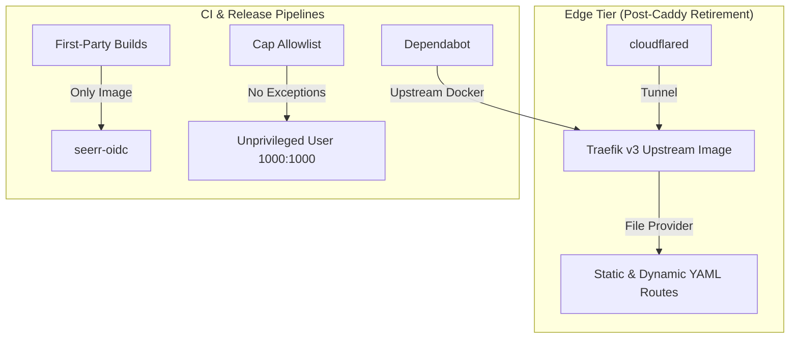

# Caddy Retirement Implementation Plan

> **For agentic workers:** REQUIRED SUB-SKILL: Use superpowers:subagent-driven-development to implement this plan task-by-task. Steps use checkbox (`- [ ]`) syntax for tracking.

**Goal:** Decommission and remove all Caddy configuration, images, capability exceptions, and first-party build workflows from the platform repository, aligning documentation and test fixtures with Traefik as the sole edge proxy per Decision 0020.

**Architecture:** Remove the deprecated Caddy module (`modules/edge/caddy.compose.yml`) and build context (`config/caddy/`), purge Caddy from the CI and post-merge image build matrices so `seerr-oidc` is the sole first-party image, drop the `NET_BIND_SERVICE` exception from `cap-allowlist.json`, update release and module test fixtures to use Traefik/seerr-oidc, and modernize all documentation and diagrams.

**Architecture Diagram:**



**Tech Stack:** Docker Compose v2, GitHub Actions, Python 3.11, pytest, ruff, Traefik v3

## Global Constraints

- Never compress code or raise budgets in `config/ci/budgets.json` (net lines must decrease per Decision 0020).
- Preserve existing comments and docstrings unrelated to Caddy removal.
- No real domains, private IPs, or secrets in any file or test fixture (Decision 0002).
- Every image remains digest-pinned; no new capability exceptions (Decision 0008, 0009).
- Run `uvx pre-commit run --all-files` and `scripts/dev/gate --fast` for verification.

---

### Task 1: Module and Build Scaffolding Retirement

**Files:**
- Delete: `modules/edge/caddy.compose.yml`
- Delete: `config/caddy/Caddyfile`
- Delete: `config/caddy/Dockerfile`
- Delete: `config/caddy/docker-entrypoint.sh`
- Modify: `.env.example:7`
- Modify: `.github/dependabot.yml:20-26`
- Modify: `scripts/release/reconcile.py:30`
- Test: `tests/release/test_reconcile.py`

**Interfaces:**
- Consumes: Existing Compose files and reconcile rules.
- Produces: Clean tree without `config/caddy/` and `modules/edge/caddy.compose.yml`.

- [ ] **Step 1: Write failing test verifying caddy watch path is gone**

In `tests/release/test_reconcile.py`, add assertion:
```python
def test_reconcile_does_not_watch_caddy_directory():
    from scripts.release import reconcile
    assert "config/caddy/" not in reconcile.REBUILD_PATHS
```

- [ ] **Step 2: Run test to verify it fails**

Run: `pytest tests/release/test_reconcile.py::test_reconcile_does_not_watch_caddy_directory -v`
Expected: FAIL (assertion error: `"config/caddy/"` is currently in `REBUILD_PATHS`)

- [ ] **Step 3: Remove Caddy files and configuration references**

Delete `modules/edge/caddy.compose.yml` and `config/caddy/`:
```bash
rm -f modules/edge/caddy.compose.yml
rm -rf config/caddy
```

In `.env.example`, remove line 7:
```diff
-CADDY_IMAGE=caddy:2.9-alpine
```

In `.github/dependabot.yml`, remove the `/config/caddy` docker entry:
```diff
-  - package-ecosystem: docker
-    directory: /config/caddy
-    schedule:
-      interval: weekly
-    groups:
-      docker:
-        patterns: ["*"]
```

In `scripts/release/reconcile.py`, remove `"config/caddy/"`:
```diff
 REBUILD_PATHS = (
-    "config/caddy/",
     "config/seerr-oidc/",
     "build/seerr-oidc/",
```

- [ ] **Step 4: Run test to verify it passes**

Run: `pytest tests/release/test_reconcile.py::test_reconcile_does_not_watch_caddy_directory -v`
Expected: PASS

- [ ] **Step 5: Verify compose policy across remaining modules**

Run: `python3 -m scripts.release.compose_policy modules/`
Expected: PASS (exit code 0)

- [ ] **Step 6: Commit**

```bash
git add .env.example .github/dependabot.yml scripts/release/reconcile.py tests/release/test_reconcile.py
git rm modules/edge/caddy.compose.yml config/caddy/Caddyfile config/caddy/Dockerfile config/caddy/docker-entrypoint.sh
git commit -m "feat(edge): retire Caddy module and build directory"
```

---

### Task 2: CI and Release Pipeline Updates

**Files:**
- Modify: `.github/workflows/ci.yml:144,175-179`
- Modify: `.github/workflows/post-merge-build.yml:32-34,40,45`
- Modify: `config/release/approved-ghcr-destinations.json:3`
- Modify: `config/release/cap-allowlist.json:2`
- Modify: `tests/ci/test_workflow_security.py:534,546`
- Modify: `tests/release/test_workflow.py:49,52,54`
- Test: `tests/ci/test_workflow_security.py`, `tests/release/test_workflow.py`

**Interfaces:**
- Consumes: Task 1 removal of `config/caddy/Dockerfile`.
- Produces: Workflow definitions building only `seerr-oidc` with zero capability allowances.

- [ ] **Step 1: Update failing tests for workflow security and build matrices**

In `tests/ci/test_workflow_security.py`:
```diff
         self.assertEqual(
             {entry["dockerfile"] for entry in image_builds["strategy"]["matrix"]["include"]},
             {
-                "config/caddy/Dockerfile",
                 "build/seerr-oidc/context/Dockerfile",
             },
         )
...
         self.assertEqual(
             {
                 entry["dockerfile"]: entry["cap_drop_check"]
                 for entry in image_builds["strategy"]["matrix"]["include"]
             },
-            {"config/caddy/Dockerfile": "true", "build/seerr-oidc/context/Dockerfile": "false"},
+            {"build/seerr-oidc/context/Dockerfile": "false"},
         )
```

In `tests/release/test_workflow.py`:
```diff
-    result = subprocess.check_output(["bash", "-c", command], env={"FILTER_CADDY": "false", "FILTER_SEERR_OIDC": "true", "FILTER_RECIPE": "false"}, text=True)
+    result = subprocess.check_output(["bash", "-c", command], env={"FILTER_SEERR_OIDC": "true", "FILTER_RECIPE": "false"}, text=True)
     selected = json.loads(result)["include"]
     assert len(selected) == 1 and selected[0]["image"] == "seerr-oidc"
-    result = subprocess.check_output(["bash", "-c", command], env={"FILTER_CADDY": "false", "FILTER_SEERR_OIDC": "false", "FILTER_RECIPE": "true"}, text=True)
+    result = subprocess.check_output(["bash", "-c", command], env={"FILTER_SEERR_OIDC": "false", "FILTER_RECIPE": "true"}, text=True)
     published = json.loads(result)["include"]
-    assert {item["image"] for item in published} == {"caddy", "seerr-oidc"}
+    assert {item["image"] for item in published} == {"seerr-oidc"}
```

- [ ] **Step 2: Run tests to verify they fail**

Run: `pytest tests/ci/test_workflow_security.py tests/release/test_workflow.py -v`
Expected: FAIL (mismatch with current workflow definitions)

- [ ] **Step 3: Update workflow and policy definitions**

In `.github/workflows/ci.yml`:
```diff
       matrix:
         include:
-          - {dockerfile: config/caddy/Dockerfile, context: config/caddy, cap_drop_check: true}
           - {dockerfile: build/seerr-oidc/context/Dockerfile, context: build/seerr-oidc/context, prepare: config/seerr-oidc/build.py, prepare_destination: build/seerr-oidc, source_lock: config/seerr-oidc/source.json, cap_drop_check: false}
```

In `.github/workflows/post-merge-build.yml`:
Remove `caddy:` path filter, `FILTER_CADDY` env var, and matrix entry:
```diff
             recipe:
               - '.github/workflows/post-merge-build.yml'
               - 'config/release/approved-ghcr-destinations.json'
-            caddy:
-              - 'config/caddy/**'
-              - 'config/caddy/Dockerfile'
             seerr-oidc:
               - 'config/seerr-oidc/**'
       - name: Create build matrix
         id: matrix
         env:
-          FILTER_CADDY: ${{ steps.filter.outputs.caddy }}
           FILTER_SEERR_OIDC: ${{ steps.filter.outputs.seerr-oidc }}
           FILTER_RECIPE: ${{ steps.filter.outputs.recipe }}
         run: |
           matrix=$(jq -cn '[
-            {"dockerfile":"config/caddy/Dockerfile","context":"config/caddy","image":"caddy","changed":env.FILTER_CADDY},
             {"dockerfile":"build/seerr-oidc/context/Dockerfile","context":"build/seerr-oidc/context","image":"seerr-oidc","prepare":"config/seerr-oidc/build.py","prepare_destination":"build/seerr-oidc","source_lock":"config/seerr-oidc/source.json","changed":env.FILTER_SEERR_OIDC}
           ] | map(select(.changed == "true" or env.FILTER_RECIPE == "true") | del(.changed)) | {include:.}')
```

In `config/release/approved-ghcr-destinations.json`:
```diff
 {
   "destinations": [
-    "ghcr.io/jon-robbins/homelab/caddy",
     "ghcr.io/jon-robbins/homelab/seerr-oidc"
   ]
 }
```

In `config/release/cap-allowlist.json`:
```diff
 {
-  "capabilities": ["CHOWN", "DAC_OVERRIDE", "FOWNER", "SETGID", "SETUID", "NET_BIND_SERVICE"]
+  "capabilities": ["CHOWN", "DAC_OVERRIDE", "FOWNER", "SETGID", "SETUID"]
 }
```

- [ ] **Step 4: Run tests to verify they pass**

Run: `pytest tests/ci/test_workflow_security.py tests/release/test_workflow.py -v`
Expected: PASS

- [ ] **Step 5: Commit**

```bash
git add .github/workflows/ci.yml .github/workflows/post-merge-build.yml config/release/approved-ghcr-destinations.json config/release/cap-allowlist.json tests/ci/test_workflow_security.py tests/release/test_workflow.py
git commit -m "ci: remove Caddy from build workflows and drop NET_BIND_SERVICE capability allowance"
```

---

### Task 3: Test Suite Alignment (Release, Modules, Fixtures)

**Files:**
- Modify: `tests/release/test_compose_policy.py:127,206-209`
- Modify: `tests/release/test_bootstrap.py:6`
- Modify: `tests/release/test_compile.py:14-15,21,25,36,41,46`
- Modify: `tests/release/test_unbuilt_commits.py:31,45`
- Modify: `tests/release/test_github.py:108`
- Modify: `tests/release/test_compare.py:61`
- Modify: `tests/release/fixtures/site/compose.json:4,7`
- Modify: `tests/release/fixtures/site/manifest.yaml:4,11`
- Modify: `tests/modules/site/site.yaml:7,27`
- Modify: `tests/modules/owner_site/site.yaml:7,26`
- Rename: `tests/modules/owner_site/overrides/caddy.yml` -> `tests/modules/owner_site/overrides/traefik.yml`
- Modify: `tests/modules/test_catalog.py:43,49-51,155`
- Modify: `tests/modules/test_owner_site.py:117-120`
- Test: `pytest tests/release/ tests/modules/`

**Interfaces:**
- Consumes: Clean policy without `NET_BIND_SERVICE` or Caddy image pins.
- Produces: 100% passing test suite reflecting Traefik edge and `seerr-oidc` first-party image.

- [ ] **Step 1: Write failing assertions in test files**

In `tests/release/test_compose_policy.py`, remove `test_caddy_can_keep_its_image_bind_capability` and remove caddy from line 127:
```diff
-    for image in ("traefik:v3.7.17" + DIGEST, "docker.io/library/caddy:2.11.7" + DIGEST):
+    for image in ("traefik:v3.7.17" + DIGEST, "docker.io/other/traefik:v3.7.17" + DIGEST):
```
Remove lines 206-209.

In `tests/release/test_bootstrap.py`:
```diff
-IMAGES = {"caddy", "agent"}
+IMAGES = {"seerr-oidc", "agent"}
```

In `tests/release/test_compile.py`:
Replace caddy fixtures with `seerr-oidc` and edge fixture with upstream `traefik`:
```diff
-BUILT = "ghcr.io/jon-robbins/homelab/caddy@sha256:" + "b" * 64
-REFS = {"caddy": BUILT}
+BUILT = "ghcr.io/jon-robbins/homelab/seerr-oidc@sha256:" + "b" * 64
+REFS = {"seerr-oidc": BUILT}
...
-            "proxy": {"image": "ghcr.io/jon-robbins/homelab/caddy@sha256:" + "0" * 64},
+            "proxy": {"image": "ghcr.io/jon-robbins/homelab/seerr-oidc@sha256:" + "0" * 64},
...
-    edge = {"services": {"caddy": {"image": "ghcr.io/jon-robbins/homelab/caddy@sha256:" + "0" * 64}}}
+    edge = {"services": {"traefik": {"image": "docker.io/library/traefik:v3.7.17@sha256:" + "0" * 64}}}
...
-    assert edge["services"]["caddy"]["image"] == BUILT
+    assert edge["services"]["traefik"]["image"] == "docker.io/library/traefik:v3.7.17@sha256:" + "0" * 64
...
-    assert app["services"]["proxy"]["image"] == REFS["caddy"]
+    assert app["services"]["proxy"]["image"] == REFS["seerr-oidc"]
...
-    with pytest.raises(ValidationError, match="no built digest for first-party image caddy"):
+    with pytest.raises(ValidationError, match="no built digest for first-party image seerr-oidc"):
```

In `tests/release/test_unbuilt_commits.py`:
```diff
-    "config/caddy/Dockerfile",
+    "build/seerr-oidc/context/Dockerfile",
...
-    client.commit["files"] = [{"filename": "docs/caddy.md", "previous_filename": "config/caddy/README.md"}]
+    client.commit["files"] = [{"filename": "docs/seerr-oidc.md", "previous_filename": "config/seerr-oidc/README.md"}]
```

In `tests/release/test_github.py`:
```diff
-    path = client.download_artifact_member("owner/repo", {"id": 9, "name": "oci-caddy"}, "oci-layout.tar", tmp_path)
+    path = client.download_artifact_member("owner/repo", {"id": 9, "name": "oci-seerr-oidc"}, "oci-layout.tar", tmp_path)
```

In `tests/release/test_compare.py`:
```diff
-    assert compare({"caddy": {"ports": [PLEX["ports"][0], second]}}, {"caddy": {"ports": [second, PLEX["ports"][0]]}}) == {}
+    assert compare({"traefik": {"ports": [PLEX["ports"][0], second]}}, {"traefik": {"ports": [second, PLEX["ports"][0]]}}) == {}
```

In `tests/release/fixtures/site/compose.json` and `manifest.yaml`:
Replace `ghcr.io/jon-robbins/homelab/caddy` with `ghcr.io/jon-robbins/homelab/seerr-oidc`.

- [ ] **Step 2: Update module fixtures and catalog assertions**

In `tests/modules/site/site.yaml`:
```diff
-  caddy: {}
+  traefik: {}
...
-managed: [caddy, cloudflared, ...
+managed: [traefik, cloudflared, ...
```

In `tests/modules/owner_site/site.yaml`:
```diff
-  caddy: {}
+  traefik: {}
...
-exposed: [caddy:80/tcp, caddy:8443/tcp, ...
+exposed: [traefik:80/tcp, traefik:8443/tcp, ...
```

Rename `tests/modules/owner_site/overrides/caddy.yml` to `tests/modules/owner_site/overrides/traefik.yml` and rename key `caddy:` to `traefik:`.

In `tests/modules/test_catalog.py`:
```diff
-    assert set(result.edge["services"]) == {"caddy", "cloudflared"}
+    assert set(result.edge["services"]) == {"traefik", "cloudflared"}
...
-    assert edge["caddy"]["user"] == "1000:1000"
-    assert edge["caddy"]["cap_drop"] == ["ALL"]
-    assert edge["caddy"]["cap_add"] == ["NET_BIND_SERVICE"]
+    assert edge["traefik"]["user"] == "1000:1000"
+    assert edge["traefik"]["cap_drop"] == ["ALL"]
+    assert "cap_add" not in edge["traefik"]
...
-        ("caddy", "443", "tcp"): tailnet,
+        ("traefik", "443", "tcp"): tailnet,
```

In `tests/modules/test_owner_site.py`:
```diff
-        ("caddy", "443", "tcp"): ENV["TAILSCALE_IP"],
-        ("caddy", "9443", "tcp"): "127.0.0.1",
-        ("caddy", "80", "tcp"): None,
-        ("caddy", "8443", "tcp"): None,
+        ("traefik", "443", "tcp"): ENV["TAILSCALE_IP"],
+        ("traefik", "9443", "tcp"): "127.0.0.1",
+        ("traefik", "80", "tcp"): None,
+        ("traefik", "8443", "tcp"): None,
```

- [ ] **Step 3: Run release and module test suites**

Run: `pytest tests/release/ tests/modules/ -v`
Expected: ALL PASS

- [ ] **Step 4: Commit**

```bash
git add tests/release/ tests/modules/
git commit -m "test: align release and module fixtures and tests with Traefik"
```

---

### Task 4: Documentation, Diagrams, and Code Comment Modernization

**Files:**
- Modify: `AGENTS.md:58`
- Modify: `README.md:12,63`
- Modify: `docs/README.md:9`
- Modify: `docs/accounts.md:11-13`
- Modify: `docs/architecture/overview.md:31,44,45,56,111`
- Modify: `docs/configuration.md:20,46,47,59`
- Modify: `docs/getting-started.md:59,125,129`
- Modify: `docs/ingress.md`
- Modify: `docs/module-migration.md:37,47`
- Modify: `docs/modules.md:42,46`
- Modify: `docs/operations.md:53`
- Modify: `docs/security.md:32,33,41,78`
- Modify: `docs/troubleshooting.md:58,61,64`
- Modify: `docs/images/readme-architecture-overview.svg`, `docs/images/readme-architecture.svg`
- Modify: `config/autobrr/config.toml.example:7`
- Modify: `modules/app/slskd.compose.yml:6`
- Modify: `scripts/release/compare.py:5`
- Test: `python3 scripts/ci/public-readiness.py`, `uvx pre-commit run --all-files`

**Interfaces:**
- Consumes: Decommissioned Caddy components.
- Produces: Accurate documentation describing Traefik v3 architecture and remotely managed Cloudflare tunnel ingress.

- [ ] **Step 1: Update troubleshooting tables and repository READMEs**

In `AGENTS.md`:
```diff
-| Route returns 404/403 through Caddy | [ingress](docs/ingress.md#caddy-routes) |
+| Route returns 404/403 through Traefik | [ingress](docs/ingress.md#traefik-routes) |
```

In `README.md`:
Replace `Caddy, cloudflared` with `Traefik, cloudflared`. Update `config/` description.

- [ ] **Step 2: Update documentation pages in `docs/`**

- In `docs/ingress.md`: rewrite the Caddy section to document Traefik file-provider routes and dynamic configuration; note in the Cloudflare Tunnel section that tunnel ingress rules are managed remotely.
- In `docs/architecture/overview.md`: update edge tier tables and remove first-party Caddy description.
- In `docs/configuration.md`: replace `caddy: {}` in example `site.yaml` with `traefik: {}`, update route references.
- In `docs/getting-started.md`: update route startup instructions from `caddy` to `traefik`.
- In `docs/security.md`, `docs/modules.md`, `docs/operations.md`, `docs/troubleshooting.md`: remove `NET_BIND_SERVICE` exception and replace Caddy references with Traefik.

- [ ] **Step 3: Update SVG architecture diagrams**

Update label text inside `docs/images/readme-architecture-overview.svg` and `docs/images/readme-architecture.svg` from `caddy` to `traefik`.

- [ ] **Step 4: Update remaining code comments**

- `config/autobrr/config.toml.example`: update comment referencing `Caddy handle_path` to Traefik strip-prefix middleware.
- `modules/app/slskd.compose.yml`: update comment from `Caddy proxies it` to `Traefik proxies it`.
- `scripts/release/compare.py`: update comment mentioning `a Caddy port` to `a Traefik port`.

- [ ] **Step 5: Run public readiness and lint checks**

Run: `python3 scripts/ci/public-readiness.py && uvx pre-commit run --all-files`
Expected: ALL PASS

- [ ] **Step 6: Commit**

```bash
git add AGENTS.md README.md docs/ config/ modules/ scripts/
git commit -m "docs: modernize architecture, ingress, and operational guides for Traefik"
```

---

### Task 5: Final Verification and Gate Check

**Files:**
- Audit: All repository files
- Test: Full pre-commit and gate suites

**Interfaces:**
- Consumes: All commits from Tasks 1-4.
- Produces: Fully verified, clean branch ready for merge/PR.

- [ ] **Step 1: Check for any remaining stray Caddy references**

Run: `git grep -i "caddy"`
Expected: Matches only in historical decision records (`docs/decisions/`), archived plans (`docs/superpowers/`), and commit messages. Zero live operational or code hits.

- [ ] **Step 2: Run pre-commit checks**

Run: `uvx pre-commit run --all-files`
Expected: All hooks pass cleanly.

- [ ] **Step 3: Run gate tests**

Run: `scripts/dev/gate --fast`
Expected: Gate test suite passes with zero errors.

- [ ] **Step 4: Check complexity budgets**

Run: `python3 scripts/ci/complexity-budget.py`
Expected: Code line counts strictly within budget.
